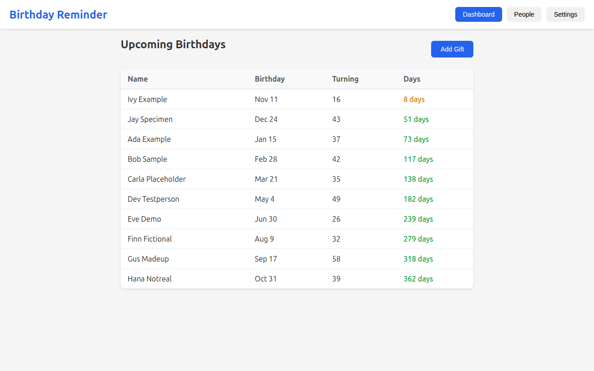
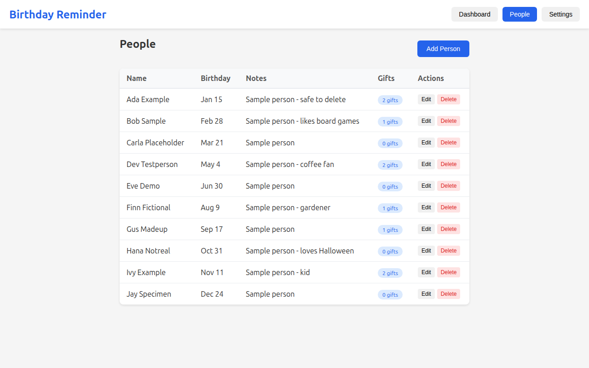
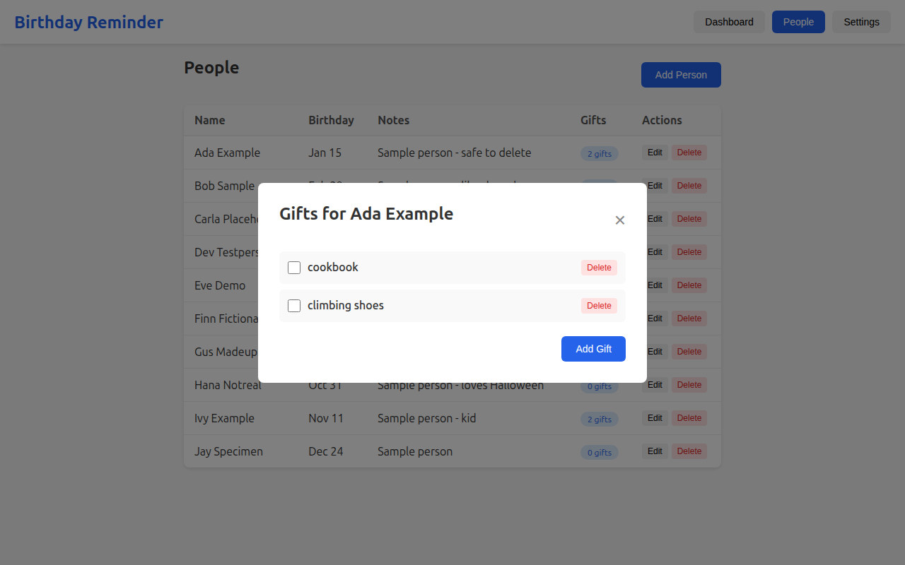
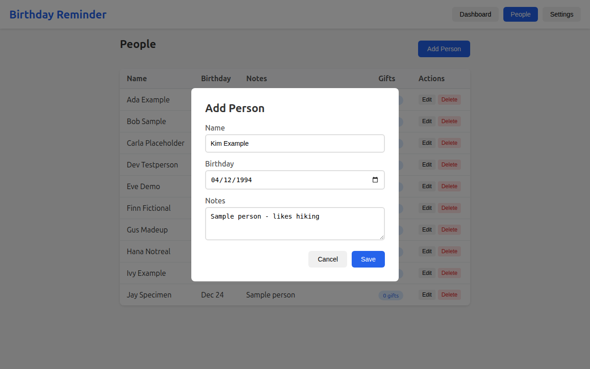
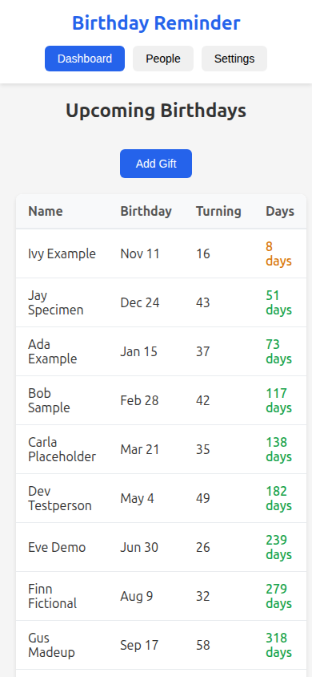
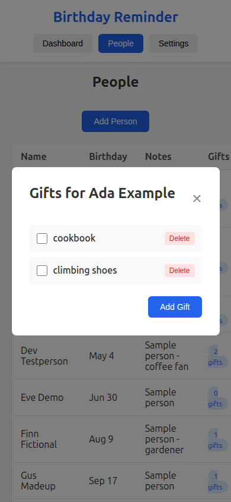
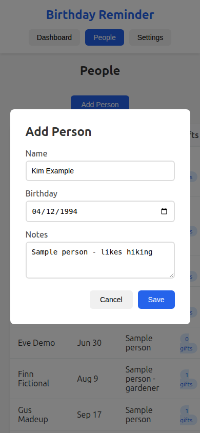

# Birthday Bot

A private birthday reminder that lives in Telegram (a free chat app, like WhatsApp).

- **Reminds you** every morning when someone's birthday is coming up: 60, 30, 7 and 1 days before and on the day. Once you have marked a gift as bought, it only reminds you at 7 days, 1 day and on the day.
- **Remembers gift ideas.** Text the bot `gift for ada - cookbook` and it's saved. Text `bought ada - cookbook` when you've bought it.
- **Has a simple web page** for adding people and editing details.
- **Keeps your data on your own computer.** Nothing goes to anyone else except the messages Telegram delivers to you.

It runs with Docker, a free tool that runs ready-made software packages ("containers") with one command. You don't need to know how to program.

## Screenshots

All names below are the made-up people from `samples/sample-birthdays.csv`.

**Upcoming birthdays**, soonest first, with the age they're turning:



**People**, with notes and how many gift ideas each person has:



**Gift ideas for one person.** Tick an idea once you've bought it:



**Adding a person:**



**On a phone:**

<table>
  <tr>
    <td></td>
    <td></td>
    <td></td>
  </tr>
  <tr>
    <td align="center">Upcoming birthdays</td>
    <td align="center">Gift ideas</td>
    <td align="center">Add a person</td>
  </tr>
</table>

---

## What you need

1. **A computer that stays on**, such as a desktop, a home server or a Raspberry Pi. The bot can only send reminders while this computer is running. Windows, Mac and Linux all work.
2. **Docker**
   - Windows or Mac: install [Docker Desktop](https://www.docker.com/products/docker-desktop/) and start it.
   - Linux: follow [the official install guide](https://docs.docker.com/engine/install/).
   - To check it works, open a terminal (on Windows, "PowerShell") and type `docker compose version`. You should see a version number.
3. **A Telegram account** on your phone.
4. **This folder** on your computer. Download it as a ZIP from the project page and unzip it, or run `git clone <project address>`.

---

## Setup (about 10 minutes)

### Step 1: Create your bot with @BotFather

BotFather is Telegram's official tool for making bots.

1. In Telegram, search for **@BotFather** (it has a blue tick) and open the chat.
2. Send `/newbot`.
3. When it asks for a **name**, choose anything you like, e.g. `My Birthday Bot`.
4. When it asks for a **username**, choose one that ends in `bot`, e.g. `ada_birthday_bot`. Usernames must be unique, so you may need to try a few.
5. BotFather replies with a **token**: a long code like `1234567890:AAAbbb...`. **This is the password to your bot.** Copy it somewhere safe and don't share it.
6. Optional, for the "Search by typing" button: send `/setinline` to BotFather, pick your bot and send any placeholder text, such as `Search people...`.

### Step 2: Start a chat with your bot

Search Telegram for the username you just chose, open it and press **Start**. (Nothing happens yet; that's expected.)

### Step 3: Find your chat id

Your chat id is a number that identifies your Telegram account. The bot only replies to this number and ignores everyone else.

The easiest way to get it is to open Telegram, search for **@userinfobot**, press Start and copy the number it shows as your **Id**.

Alternatively, after Step 2, open this address in a web browser (replace `<TOKEN>` with your token) and find `"chat":{"id":` followed by a number:

```
https://api.telegram.org/bot<TOKEN>/getUpdates
```

### Step 4: Fill in your settings

1. In this folder, make a copy of the file `.env.example` and name the copy `.env`. The name starts with a dot. On a Mac or Linux, files that start with a dot can be hidden: press Cmd+Shift+. in Finder to show them, or run `cp .env.example .env` in a terminal.
2. Open `.env` in any text editor (Notepad, TextEdit, etc.) and set:
   - `BIRTHDAY_BOT_TOKEN`: your token from Step 1
   - `BIRTHDAY_BOT_CHAT_ID`: your number from Step 3
   - `TZ`: your timezone, such as `Europe/London` or `America/New_York` ([full list](https://en.wikipedia.org/wiki/List_of_tz_database_time_zones), "TZ identifier" column)
   - `POSTGRES_PASSWORD`: any long password you make up. It is only used inside your computer, but **set it before the first start**.
3. Save the file. Leave everything else as it is for now.

### Step 5: Start it

Open a terminal **in this folder** and run:

```
docker compose up -d
```

The first run downloads and builds everything, which takes a few minutes. `-d` means it keeps running in the background, and it starts again automatically when the computer restarts, as long as Docker is set to start at login.

### Step 6: Check it works

1. Run `docker compose ps`. You should see three lines (`db`, `api`, `bot`), each saying `Up`, and `db`/`api` saying `(healthy)`.
2. Open **http://localhost:8000** in your browser. You should see the birthday web page (empty for now).
3. In Telegram, send `/start` to your bot. A menu with buttons should appear.

If something doesn't work, see [Troubleshooting](#troubleshooting).

---

## Adding birthdays

Nothing is loaded until you add it. Choose one of these:

**A. Use the web page.** Open http://localhost:8000 and click to add a person (name and birthday). This is the easiest way for a few people.

**B. Try the sample data first.** The `samples/` folder has 10 made-up people (Ada Example, Bob Sample and others), so you can see how things look:

```
docker compose exec api python /scripts/import_birthdays.py /samples/sample-birthdays.csv
```

Delete them later from the web page.

**C. Import your own list from a spreadsheet.**
1. In Excel, Numbers or Google Sheets, make a sheet with these four column headings exactly: `name`, `birthday`, `notes`, `gift_ideas`.
   - `birthday` must be written as **YYYY-MM-DD**, e.g. `1990-01-15`.
   - `notes` and `gift_ideas` can be left empty. Separate several gift ideas with `;`.
   - See `samples/sample-birthdays.csv` for an example.
2. Save or download it as **CSV** and put it in this project's `data/` folder, e.g. `data/my-birthdays.csv`. Files in `data/` are never uploaded if you use git.
3. Run:
   ```
   docker compose exec api python /scripts/import_birthdays.py /data/my-birthdays.csv
   ```
   It's safe to run more than once, because people already in the list are skipped.

Tip: add yourself too. The bot will remind you about your own birthday as well, which is a handy nudge to share a wishlist with your family.

---

## Using the bot

| You type | What happens |
|---|---|
| `/menu` | Buttons: upcoming birthdays, browse gift lists, add an idea |
| `/upcoming` | List of the next birthdays |
| `ada` | Shows Ada's birthday and gift ideas |
| `gift for ada - cookbook` or `ada: cookbook` | Saves a gift idea |
| `bought ada - cookbook` | Marks it as bought |
| `/help` | Shows all of this |

Every morning at 9:00 in your timezone (change it with `DAILY_CHECK_HOUR` in `.env`), the bot messages you about upcoming birthdays. The day after a birthday, gifts you marked as bought are moved to history, so next year's list starts fresh. Ideas you didn't buy are kept.

To add new people or fix a date, use the web page. The bot can't do that.

---

## Opening the web page from your phone

The web page **has no password**. That's why, by default, it only works on the computer that runs it.

To open it from other devices **on your home Wi-Fi**:
1. In `.env`, set `API_BIND=0.0.0.0`.
2. Find your computer's local network address. It usually starts with `192` or `10`, and your computer's network settings show it. Set `WEB_APP_URL=http://<that address>:8000`.
3. Run `docker compose up -d` again.

**Never make it reachable from the internet** (for example with "port forwarding" on your router). Anyone could read and change your list. If you want access from outside your home, put it behind a login, using something like a VPN such as Tailscale, or Cloudflare Access.

---

## Updating to a new version

```
git pull
docker compose up -d --build
```

(If you downloaded a ZIP, download the new ZIP, copy your `.env` and `data/` folder into it, and run `docker compose up -d --build` from the new folder. Your birthdays are stored in Docker, not in the folder, so they carry over.)

---

## Backing up your data

Your birthdays are stored in a Docker "volume" (a storage area that Docker manages) on this computer. They're not in this folder, and they're not uploaded anywhere.

**Make a backup** (creates a file in `backups/`):

```
mkdir -p backups
docker compose exec -T db pg_dump -U birthday birthday > backups/birthdays-backup.sql
```

(If you changed `POSTGRES_USER` or `POSTGRES_DB` in `.env`, use your values instead of `birthday`.)

Copy that file somewhere safe, such as a USB stick or your own cloud drive. **Don't commit it to git or share it publicly.** It contains everyone's names and birthdays. The `.gitignore` file already excludes `backups/`.

**Restore a backup** onto a fresh install:

```
docker compose up -d
docker compose exec -T db psql -U birthday birthday < backups/birthdays-backup.sql
```

**Warning:** `docker compose down -v` deletes the volume, which deletes **all your data**. Plain `docker compose down` (without `-v`) is safe.

---

## Troubleshooting

**See what's going on:** `docker compose logs bot` (or `api`, `db`). Add `-f` to keep watching, and press Ctrl+C to stop.

- **The bot doesn't reply at all**
  - Run `docker compose logs bot`. If you see `InvalidToken` or `rejected by the server`, the token in `.env` is wrong. Copy it again from @BotFather (send `/token` there), then run `docker compose up -d`.
  - If the log says `ignored message from unauthorized chat_id=...`, the number in `BIRTHDAY_BOT_CHAT_ID` is wrong. Use the number from that log line.
  - After any change to `.env`, run `docker compose up -d` again.
- **`docker compose up` says "Set BIRTHDAY_BOT_TOKEN in .env"**: you haven't created `.env` yet, or it's in a different folder. See Step 4.
- **"port is already allocated"**: something else on your computer uses port 8000. Set `API_PORT=8001` (and `WEB_APP_URL=http://localhost:8001`) in `.env`, then run `docker compose up -d`.
- **Reminders arrive at the wrong time**: check that `TZ` in `.env` is in Region/City form, such as `Europe/Berlin`, then run `docker compose up -d`.
- **The database won't start after changing `POSTGRES_PASSWORD`**: the password is fixed when the database is first created. Put the old one back. Or, if you have no data worth keeping, run `docker compose down -v` (this **deletes everything**) and start again.
- **"Search by typing" does nothing**: turn on inline mode with `/setinline` in @BotFather (Step 1.6).
- **Email or browser notifications from the web page**: these are optional extras (see the bottom of `.env.example`). Telegram reminders work without them.
- **Optional uptime alerts**: set `HEALTHCHECKS_API_KEY` (from healthchecks.io) to get an email if the daily reminder ever stops running. Leave it blank to switch this off.

---

## How it's built (for the curious)

- `bot/`: the Telegram bot (Python, python-telegram-bot). It holds no data and asks the API for everything.
- `api/`: the web page and API (Python, FastAPI) on top of a PostgreSQL database.
- `docker-compose.yml`: runs the database, the API and the bot together.
- `scripts/import_birthdays.py`: the CSV importer.

Run the tests: `docker compose run --rm --no-deps bot python -m unittest discover -s tests` and `docker compose run --rm --no-deps api sh -c "pip install -q httpx==0.27.2 && python -m unittest discover -s tests"`.

## Credits and license

Made by Graeme Crawley. MIT license: see [LICENSE](LICENSE). Use it, change it and share it.
